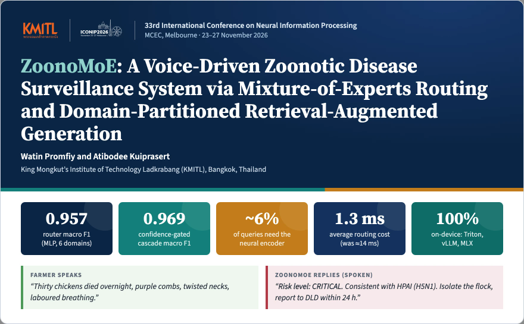
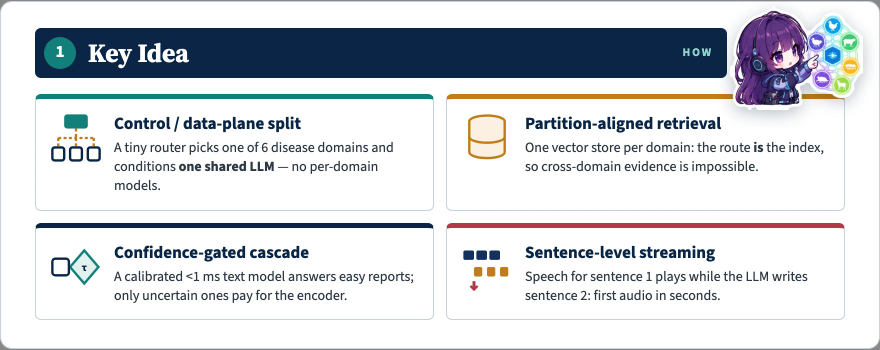
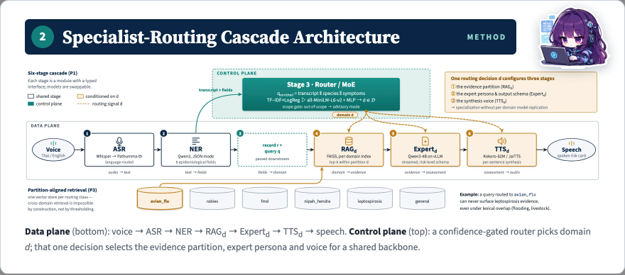
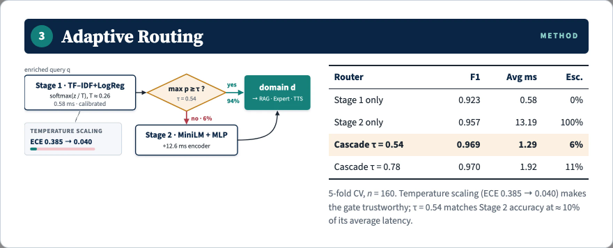
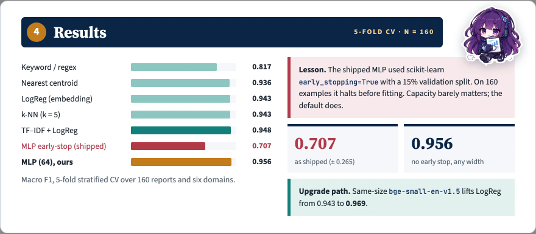
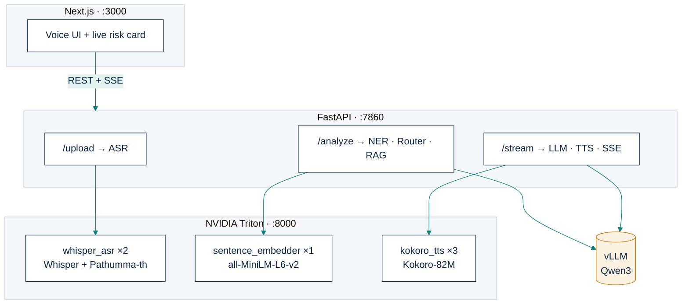

<p align="center">
  
</p>

<p align="center">
  <a href="paper/ZoonoMoE-ICONIP2026.pdf"></a>
  <a href="#-demo-samples--verified-run"></a>
  <a href="#under-the-hood"></a>
  <a href="#under-the-hood"></a>
  
</p>
<p align="center">
  
  
  
  
  
  
</p>


<p align="center">
  
</p>

## Highlights

- **System-level Mixture-of-Experts.** A cheap, calibrated router (the *control plane*) picks 1 of 6 disease domains; that one decision selects the evidence partition, the expert persona and the voice for a single shared LLM (the *data plane*). No per-domain model copies.
- **Confidence-gated cascade.** TF–IDF + calibrated LogReg answers easy reports in < 1 ms; only the uncertain ~6% go to MiniLM + MLP. Cascade macro F1 **0.969** at **1.29 ms** average, versus **0.957** at ~13 ms for the embedding router alone.
- **Partition-aligned retrieval.** One FAISS index per domain, so a report routed to `avian_flu` can never retrieve leptospirosis evidence.
- **Fully on-device.** ASR, LLM, retrieval and TTS all run locally on Apple Silicon, NVIDIA GPUs or CPU. No cloud API; no data leaves the machine.
- **Bilingual, streamed voice.** English (Kokoro-82M) and Thai (JaiTTS / F5-TTS), synthesised sentence by sentence; first audio plays ~3–5 s after generation starts.
- **Verified end to end** on an NVIDIA A100-40 GB (6/6 stages), with playable [audio samples](#-demo-samples--verified-run).

<p align="center">
  
</p>

<p align="center">
  
  
</p>


<p align="center"></p>

### 💻 Platform support

| Platform | ASR | LLM | TTS | Inference |
|---|---|---|---|---|
| Apple Silicon (M-series) | mlx-whisper | mlx-lm Qwen3-4B (4-bit) | Kokoro local pool | MLX |
| Linux + NVIDIA GPU (cc ≥ 8.0) | Whisper + Pathumma-th via **Triton** | vLLM, Qwen3-4B fp16 | Kokoro via **Triton** | Triton + vLLM |
| Linux + NVIDIA GPU (T4, cc 7.5) | Whisper + Pathumma-th via **Triton** | vLLM, Qwen3-4B AWQ 8-bit | Kokoro via **Triton** | Triton + vLLM |
| Linux, CPU only | Whisper + Pathumma-th | vLLM CPU, Qwen2.5-1.5B | Kokoro local pool | vLLM |

### 🍎 Mac (Apple Silicon)

```bash
git clone https://github.com/E27-25/ZoonoMoE-Specialist-Routing-Cascade.git
cd ZoonoMoE-Specialist-Routing-Cascade

# Backend
cd backend
python3 -m venv venv && source venv/bin/activate
pip install -r requirements.txt
USE_MLX=true python3 app.py

# Frontend (separate terminal)
cd frontend
npm install
npm run dev
```

Open **http://localhost:3000**.

### 🐳 Docker (Linux + NVIDIA GPU), recommended

```bash
git clone https://github.com/E27-25/ZoonoMoE-Specialist-Routing-Cascade.git
cd ZoonoMoE-Specialist-Routing-Cascade
docker compose up --build
```

| Service | URL |
|---|---|
| Frontend | http://localhost:3000 |
| Backend API | http://localhost:7860 |
| Triton | http://localhost:8000 |

### 🧪 Try these reports

| Domain | Input |
|---|---|
| Avian flu | `30 chickens died this morning with purple combs and twisted necks, labored breathing` |
| FMD | `My cattle have blisters on tongue and feet, limping badly and salivating heavily` |
| Nipah / Hendra | `Pig farmer here — pigs died suddenly overnight, two workers now have fever and confusion` |
| Leptospirosis | `Five rice farmers have fever, muscle pain, red eyes after wading in flooded paddy fields` |
| Rabies | `A stray dog bit two children — foaming at the mouth, running in circles before collapsing` |
| Chat (scope gate) | `Hi, how do I protect myself when working near livestock?` |


<a id="under-the-hood"></a>
<p align="center"></p>

### 🔄 The six stages

<details>
<summary><b>Stage 1 · ASR</b> &nbsp;<sub>audio → text</sub></summary>
<br/>

| | |
|---|---|
| **Input** | WebM blob from the browser `MediaRecorder` |
| **Convert** | `ffmpeg` → 16 kHz mono WAV |
| **Language detection** | Whisper base `detect_language()` |
| **Thai** | `nectec/Pathumma-whisper-th-medium` |
| **Other** | `openai/whisper-base` |
| **Guard** | a word repeated > 6× or top-3 words > 80% of tokens → reject and ask to re-record |

</details>

<details>
<summary><b>Stage 2 · NER</b> &nbsp;<sub>text → structured fields</sub></summary>
<br/>

A JSON-mode prompt extracts 8 fields (chain-of-thought spans stripped, schema default on parse failure):

| Field | Example |
|---|---|
| `species` | `["chicken", "duck"]` |
| `symptoms` | `["cyanotic combs", "twisted neck"]` |
| `mortality_count` | `30` |
| `affected_count` | `50` |
| `location` | `"near the pond"` |
| `timeframe` | `"this morning"` |
| `reporter_role` | `"farmer"` |
| `raw_summary` | one-liner for downstream prompts |

</details>

<details>
<summary><b>Stage 3 · Router / MoE</b> &nbsp;<sub>fields + text → domain</sub></summary>
<br/>

The control plane classifies an **enriched query**, `transcript ‖ "Species: …" ‖ "Symptoms: …"`, into one of six domains.

- **Stage 1:** TF–IDF + logistic regression, temperature-scaled (T ≈ 0.26). Answers when its top probability ≥ τ = 0.54.
- **Stage 2:** `all-MiniLM-L6-v2` embedding → `MLPClassifier(hidden_layer_sizes=(64,), early_stopping=False, alpha=1e-3)`.
- **Training-free fallback:** nearest-centroid over seed centroids (F1 0.936) when no trained router exists.
- **Scope gate:** low confidence plus no extracted species/symptoms, or a conversational opener, routes to a light advisory mode.

| Router (5-fold CV, n = 160) | Macro F1 | Avg latency | Escalated |
|---|---|---|---|
| Stage 1 only (TF–IDF) | 0.923 | 0.58 ms | 0% |
| Stage 2 only (MiniLM + MLP) | **0.957** | 13.19 ms | 100% |
| **Cascade, τ = 0.54** | **0.969** | **1.29 ms** | 6% |

Benchmark reports per domain: `avian_flu` 27 · `fmd` 25 · `general` 25 · `leptospirosis` 26 · `nipah_hendra` 30 · `rabies` 27.

> **Note:** earlier builds shipped the MLP with `early_stopping=True` and a 15% validation split. On ~160 examples that stops training before the network fits, giving macro F1 **0.707 ± 0.265** (accuracy 0.744). Turning early stopping off with mild L2 recovers ~0.96 at any hidden width. See `backend/scripts/benchmark_router.py`, `ablation_router.py` and `cascade_router.py`.

To retrain:

```bash
cd backend
python3 -c "
from pathlib import Path
from models.router import train
train(model_dir=Path('models'), extra_data=Path('data/router_training.jsonl'))
"
```

</details>

<details>
<summary><b>Stage 4 · Partition-aligned RAG</b> &nbsp;<sub>domain → evidence</sub></summary>
<br/>

- One FAISS index per disease domain (`knowledge_base/{domain}/index.pkl`)
- Embedder: `sentence-transformers/all-MiniLM-L6-v2`
- Top-3 chunks by cosine similarity, **inside the routed partition only**
- Falls back to built-in seed knowledge if an index is missing

</details>

<details>
<summary><b>Stage 5 · Conditioned expert LLM</b> &nbsp;<sub>evidence + fields → assessment</sub></summary>
<br/>

| Platform | Model | Backend |
|---|---|---|
| Apple Silicon | `mlx-community/Qwen3-4B-4bit` | mlx-lm |
| CUDA (cc ≥ 8.0) | `Qwen/Qwen3-4B` fp16 | vLLM |
| CUDA T4 (cc 7.5) | `cyankiwi/Qwen3-4B-Instruct-2507-AWQ-8bit` | vLLM + compressed-tensors |
| CPU | `Qwen/Qwen2.5-1.5B-Instruct` | vLLM |

- Domain persona + NER fields + retrieved evidence, constrained to a fixed schema
- `<think>…</think>` blocks stripped from the SSE stream
- Output: live text stream + `RISK LEVEL` badge (low / medium / high / critical) + `report_to_authorities` flag

</details>

<details>
<summary><b>Stage 6 · Streaming TTS</b> &nbsp;<sub>assessment → speech</sub></summary>
<br/>

- English: `hexgrad/Kokoro-82M`; Thai: JaiTTS / F5-TTS with a cloned public Thai reference voice (`JAITTS_SPEED`, default 0.9)
- Each sentence → WAV → base64 SSE → `AudioContext` queue, so audio starts before the full answer exists
- Voice per domain: `af_heart` / `am_michael` / `am_adam` / `af_bella`
- Controls: Pause / Resume / Stop

</details>

### 🏗️ Serving topology



> **Why not put the LLM in Triton?** vLLM SSE streaming would need Triton decoupled mode (gRPC only): a lot of added complexity for no throughput gain, because vLLM already handles concurrency with continuous batching and PagedAttention.

| Component | Parallel capacity | Mechanism |
|---|---|---|
| Whisper ASR | ×2 | Triton instance group |
| Sentence embedder | ×1 (fast, async) | Triton |
| Kokoro TTS | ×3 | Triton instance group |
| vLLM LLM | N requests batched | continuous batching + PagedAttention |

### 🎧 Demo samples & verified run

The full pipeline was validated **end to end on an NVIDIA A100-40 GB** (Qwen3-14B via vLLM, 6/6 stages green). Audio lives in [`backend/samples/`](backend/samples/):

| ▶︎ Play | Length | What |
|---|---|---|
| 🎙️ **[`input_report_en.wav`](backend/samples/input_report_en.wav)** | 13.4 s | spoken field report (**input**) |
| 🔊 **[`output_en.wav`](backend/samples/output_en.wav)** | 52.4 s | English risk assessment, Kokoro, **7 chunks** |
| 🔊 **[`output_th.wav`](backend/samples/output_th.wav)** | 48.9 s | Thai risk assessment, JaiTTS/F5 (cloned voice), **7 chunks** |
| 📝 [`output_en.txt`](backend/samples/output_en.txt) · [`output_th.txt`](backend/samples/output_th.txt) | — | per-chunk text breakdown |

```
input  : "Three of my chickens died overnight. Their combs were blue and
          swollen, and one was found convulsing... ~15 birds affected."
[1] ASR    ✓ transcribed (Whisper base)
[2] NER    ✓ species / symptoms / mortality / … extracted
[3] Router ✓ domain = avian_flu   (confidence 1.0, cascade stage 1)
[4] RAG    ✓ 3 domain chunks
[5] LLM    ✓ HPAI assessment: isolate, PPE, culling, report, human safety
[6] TTS    ✓ EN 7 chunks / 52 s  ·  TH 7 chunks / 49 s
```

Reproduce on LANTA: `sbatch backend/make_samples.sbatch` (samples) or `sbatch backend/zoono_smoke.sbatch` (per-stage PASS/FAIL). JaiTTS/F5 (Thai) is ~4× slower than Kokoro, hence the longer Thai audio.

### 📈 Performance

| Metric | Value |
|---|---|
| Router macro F1 (6-class, 5-fold CV) | **0.957** |
| Cascade macro F1 / avg routing latency | **0.969** / **1.29 ms** |
| ASR latency | ~1–2 s (Whisper base) |
| First audio | ~3–5 s after the LLM starts |
| Full pipeline (verified run, long answer) | ~15–20 s end to end |
| Concurrent users | ×3 TTS / ×2 ASR / vLLM batched |

<details>
<summary><b>⚙️ Configuration</b></summary>
<br/>

| Variable | Default | Description |
|---|---|---|
| `USE_MLX` | `auto` | `true` = MLX, `false` = vLLM, `auto` = detect |
| `USE_TRITON` | `false` | Enable Triton for ASR / embedder / TTS |
| `TRITON_URL` | `triton:8000` | Triton server address |
| `LLM_MODEL` | _(platform default)_ | Hugging Face model repo |
| `WHISPER_SIZE` | `base` | `tiny` · `base` · `small` · `medium` |
| `TTS_LANG` | `en` | set `th` for Thai JaiTTS / F5-TTS |
| `JAITTS_SPEED` | `0.9` | Thai speech pace |
| `PORT` | `7860` | Backend port |
| `DEBUG` | `false` | FastAPI debug mode |
| `DISCORD_WEBHOOK` | _(empty)_ | Discord Forum webhook for pipeline logging |
| `DATABASE_URL` | _(empty)_ | PostgreSQL connection string (Neon) |

</details>

<details>
<summary><b>🐳 Docker & ☁️ Google Cloud deployment</b></summary>
<br/>

```bash
# GPU (Triton enabled)
docker compose up --build

# With Discord logging + database
DATABASE_URL="postgresql://..." DISCORD_WEBHOOK="https://discord.com/api/webhooks/..." docker compose up --build
```

| Volume | Purpose |
|---|---|
| `./backend/knowledge_base` | RAG FAISS indexes |
| `./backend/models` | trained MLP router |
| `./backend/data` | router training data |
| `huggingface_cache` | downloaded Hugging Face models |

`triton_models/` is baked into the Triton image via `COPY triton_models /models`, so no bind mount is needed.

```bash
# 1. Build + push images
gcloud auth configure-docker asia-southeast1-docker.pkg.dev
docker compose build
docker tag zoonmoe-backend:latest  asia-southeast1-docker.pkg.dev/<PROJECT_ID>/zoonotic/backend:latest
docker tag zoonmoe-triton:latest   asia-southeast1-docker.pkg.dev/<PROJECT_ID>/zoonotic/triton:latest
docker tag zoonmoe-frontend:latest asia-southeast1-docker.pkg.dev/<PROJECT_ID>/zoonotic/frontend:latest
docker push asia-southeast1-docker.pkg.dev/<PROJECT_ID>/zoonotic/backend:latest
docker push asia-southeast1-docker.pkg.dev/<PROJECT_ID>/zoonotic/triton:latest
docker push asia-southeast1-docker.pkg.dev/<PROJECT_ID>/zoonotic/frontend:latest

# 2. On the VM: pull and run
docker compose pull
DATABASE_URL="postgresql://..." docker compose up -d
```

Requirements: NVIDIA driver ≥ 590, `nvidia-container-toolkit`, a GPU with ≥ 16 GB VRAM (T4 or better). More in [`docs/DEPLOY.md`](docs/DEPLOY.md) and [`docs/READMEtriton.md`](docs/READMEtriton.md).

</details>

<details>
<summary><b>📊 Discord pipeline logging</b></summary>
<br/>

When `DISCORD_WEBHOOK` is set, each inference run can be logged to a Discord Forum channel as its own thread via [discordflow](https://pypi.org/project/discordflow/) (installed from `backend/requirements.txt`):

```bash
export DISCORD_WEBHOOK="https://discord.com/api/webhooks/YOUR_ID/YOUR_TOKEN"
docker compose up --build
```

| Stage | Logged data |
|---|---|
| ASR | backend, latency, transcript |
| NER | all 8 extracted fields |
| Router | domain, confidence, all 6 scores |
| RAG | chunks, latency, sources |
| LLM | risk level, report flag, full assessment |
| TTS | audio chunks, latency |
| Summary | total latency + CPU/RAM metrics |

</details>

<details>
<summary><b>📁 Project structure</b></summary>
<br/>

```
ZoonoMoE-Specialist-Routing-Cascade/
├── docker-compose.yml            # Triton + backend + frontend
├── triton.Dockerfile             # custom Triton image with Python deps
├── triton_models/                # Triton model repository
│   ├── whisper_asr/              # Whisper + Pathumma-th (×2 instances)
│   ├── sentence_embedder/        # all-MiniLM-L6-v2 (×1)
│   └── kokoro_tts/               # Kokoro-82M (×3)
├── backend/
│   ├── app.py                    # FastAPI, 6-stage pipeline
│   ├── models/router.py          # router training + cascade inference
│   ├── utils/                    # rag.py · thai_tts.py
│   ├── knowledge_base/           # one FAISS partition per domain
│   ├── data/router_training.jsonl
│   ├── scripts/                  # benchmark_router · ablation_router · cascade_router
│   │                             # benchmark_pipeline · evaluate · smoke_test · make_samples
│   │   └── eval_out/             # results JSON + paper figures
│   ├── samples/                  # verified EN/TH audio
│   └── *.sbatch                  # LANTA HPC jobs
├── frontend/src/app/             # Next.js 15 app, /dashboard, API routes
├── paper/                        # ICONIP 2026 paper (LaTeX, figures, PDF)
├── docs/                         # deployment & ops guides
└── examples/sample_field_report.m4a
```

</details>

<details>
<summary><b>🛠️ Technology stack</b></summary>
<br/>

| Layer | Technology |
|---|---|
| ASR | Whisper + Pathumma-whisper-th / mlx-whisper |
| LLM / NER | Qwen3 via vLLM (CUDA) or mlx-lm (Apple Silicon) |
| Router | TF–IDF + LogReg ▷ all-MiniLM-L6-v2 + scikit-learn MLP |
| RAG | FAISS + sentence-transformers |
| TTS | Kokoro-82M (English) · JaiTTS / F5-TTS (Thai, `TTS_LANG=th`) |
| Inference server | NVIDIA Triton 26.02 (ASR + embedder + TTS) |
| Backend | FastAPI + SSE streaming |
| Frontend | Next.js 15 + Three.js / R3F |
| Database | Neon PostgreSQL: SQLAlchemy (backend) + Drizzle ORM (frontend) |
| Dashboard | Next.js `/dashboard`: report history, stats, risk distribution |
| Experiment tracking | discordflow, a team-built Discord Forum ML logger |

</details>


<p align="center"></p>

📄 **[ZoonoMoE-ICONIP2026.pdf](paper/ZoonoMoE-ICONIP2026.pdf)** · LaTeX source in [`paper/`](paper/)

```bibtex
@inproceedings{promfiy2026zoonomoe,
  title     = {ZoonoMoE: A Voice-Driven Zoonotic Disease Surveillance System via
               Mixture-of-Experts Routing and Domain-Partitioned Retrieval-Augmented Generation},
  author    = {Promfiy, Watin and Kuiprasert, Atibodee},
  booktitle = {Proceedings of the 33rd International Conference on Neural Information Processing (ICONIP)},
  year      = {2026},
  address   = {Melbourne, Australia}
}
```

**Scope.** The paper evaluates the control plane (routing quality, cascade cost and calibration). ASR word-error rate, Stage-2 extraction accuracy and a veterinary-adjudicated study of the Stage-5 risk output are future work; this system is a research prototype, not a diagnostic tool.

<details>
<summary><b>🐾 Meet the ZoonoMoE mascot</b> &nbsp;<sub>32 stickers</sub></summary>
<br/>

<table>
<tr><td align="center"></td><td align="center"></td><td align="center"></td><td align="center"></td><td align="center"></td><td align="center"></td><td align="center"></td><td align="center"></td></tr>
<tr><td align="center"></td><td align="center"></td><td align="center"></td><td align="center"></td><td align="center"></td><td align="center"></td><td align="center"></td><td align="center"></td></tr>
<tr><td align="center"></td><td align="center"></td><td align="center"></td><td align="center"></td><td align="center"></td><td align="center"></td><td align="center"></td><td align="center"></td></tr>
<tr><td align="center"></td><td align="center"></td><td align="center"></td><td align="center"></td><td align="center"></td><td align="center"></td><td align="center"></td><td align="center"></td></tr>
</table>

</details>

<p align="center">
  
</p>

<p align="center"><sub>Built at KMITL · 2026 · Thanks to the Department of Livestock Development (DLD), Thailand, for domain guidance.</sub></p>
