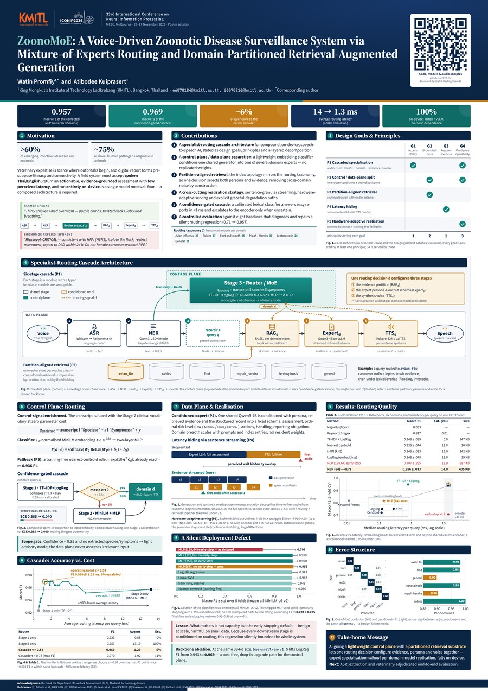
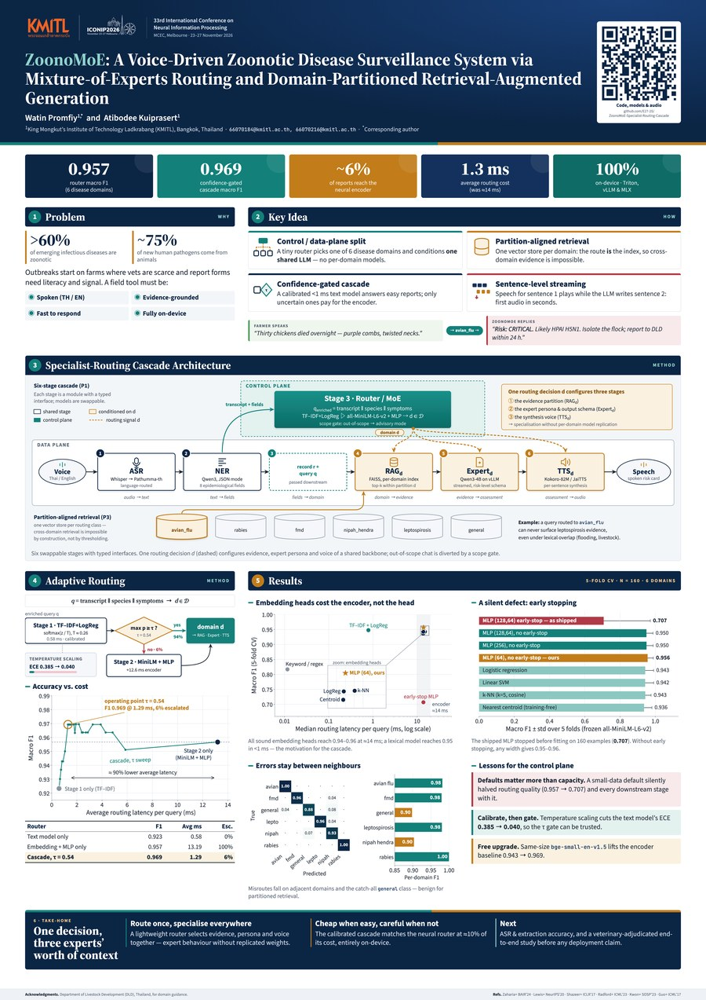

# ZoonoMoE · ICONIP 2026 poster

A0 portrait (841 × 1189 mm) poster for **ZoonoMoE**, presented at ICONIP 2026, Melbourne.

  
  

## Downloads

| Version | Print PDF (vector, best quality) | PNG (150 dpi) | Preview |
|---|---|---|---|
| Full · KMITL logo | [PDF](ZoonoMoE_A0_KMITL_full.pdf) | [PNG](ZoonoMoE_A0_KMITL_full_150dpi.png) | [JPG](ZoonoMoE_A0_KMITL_full_preview.jpg) |
| Simplified · KMITL logo | [PDF](ZoonoMoE_A0_KMITL_simplified.pdf) | [PNG](ZoonoMoE_A0_KMITL_simplified_150dpi.png) | [JPG](ZoonoMoE_A0_KMITL_simplified_preview.jpg) |
| Full · KMUTT logo | [PDF](ZoonoMoE_A0_KMUTT_full.pdf) | [PNG](ZoonoMoE_A0_KMUTT_full_150dpi.png) | [JPG](ZoonoMoE_A0_KMUTT_full_preview.jpg) |
| Simplified · KMUTT logo | [PDF](ZoonoMoE_A0_KMUTT_simplified.pdf) | [PNG](ZoonoMoE_A0_KMUTT_simplified_150dpi.png) | [JPG](ZoonoMoE_A0_KMUTT_simplified_preview.jpg) |

On a file page, use GitHub's **Download raw file** button.

## Printing

- Use the **PDF**: it is vector (text, diagrams and charts stay sharp at any size), one page at exactly A0, with all fonts embedded.
- Print at **A0 portrait, 100% scale** (not "fit to page").
- The PNGs are for screens, slides and the conference app; at 150 dpi they are fine for viewing but the PDF is better for print.
